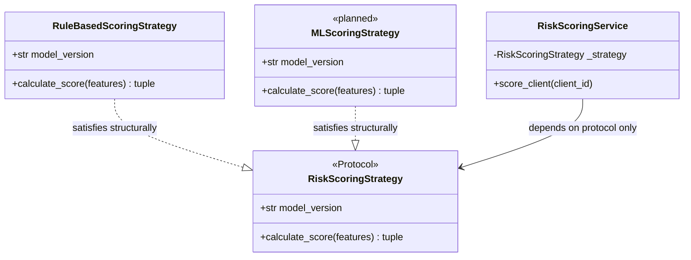

Most SOLID explainers cover all five principles in one pass, give you a definition and a toy example for each, and move on. What they skip is showing up in a codebase that already works, finding where a principle is being violated, and making the case that fixing it actually changed anything.

This post focuses on three: OCP, ISP, and LSP. They came up together in a single design decision on a FastAPI invoice-reminder service — and the interesting thing is that one construct in Python's type system addresses all three at once.

## OCP + ISP + LSP: Three Problems, One Protocol

`RiskScoringService` runs a rule-based formula today. Delay history, overdue count, outstanding amount — all weighted and combined into a risk score. It works, and the tests are green.

But there's a feature on the roadmap: an ML model that replaces the rule-based formula once enough historical data exists. When that arrives, how much of the current code needs to change?

In the original design, the answer was: *a lot*.

```python
# BEFORE: the service creates its own strategy — no way to swap it out
class RiskScoringService:
    def __init__(self, db: Client) -> None:
        self._strategy = RuleBasedScoringStrategy()  # hardwired
```

The service builds its own scoring strategy internally. There's no way to tell it "use this other one instead." When the ML model arrives, a developer has to open `RiskScoringService`, find the line that creates `RuleBasedScoringStrategy`, and modify it — then re-test the whole service, including the parts that didn't change.

This is the failure mode **OCP (Open-Closed Principle)** describes: *a module should be open for extension but closed for modification*. The operative question isn't whether the code looks tidy. It's whether adding a new thing requires changing what already works.

### Introducing the Protocol

The fix has two parts. First, define what any scoring strategy must be able to do — not by inheritance, but by declaring its shape:

```python
from typing import Protocol, runtime_checkable, Any, Literal

@runtime_checkable
class RiskScoringStrategy(Protocol):
    model_version: str  # which version of this strategy is running

    def calculate_score(
        self, features: dict[str, Any]
    ) -> tuple[float, Literal["LOW", "MEDIUM", "HIGH"]]:
        ...
```

This is a Python `Protocol`. It defines no logic. It says: *if a class has a `model_version` attribute and a `calculate_score` method with this exact signature, it qualifies as a `RiskScoringStrategy`*. No inheritance required. No registration. The class just needs to match the shape.

Second, let the service accept a strategy from outside instead of creating one itself:

```python
# AFTER: strategy is injected — the service never touches the concrete type
class RiskScoringService:
    def __init__(
        self,
        db: Client,
        strategy: RiskScoringStrategy | None = None,
    ) -> None:
        self._strategy: RiskScoringStrategy = (
            strategy if strategy is not None else RuleBasedScoringStrategy()
        )
```

Now `RiskScoringService` doesn't know which strategy it's running. It only knows the protocol: there's a `calculate_score` method, and it returns a score and a label. The rule-based strategy works today. The ML strategy plugs in tomorrow without touching this file. **OCP satisfied.**



### Why a Narrow Protocol Matters (ISP)

When the ML team sits down to write their strategy, they only need to look at two things from the protocol: one attribute and one method.

```python
class MLScoringStrategy:
    model_version = "ml-v1"

    def calculate_score(self, features: dict[str, Any]) -> tuple[float, Literal["LOW", "MEDIUM", "HIGH"]]:
        # load model, run inference, return result
        ...
```

That's it. They don't have to implement `get_summary()` or `persist_log()` or `emit_audit_event()` — none of those exist in the protocol because they belong to the service, not the strategy.

This is what **ISP (Interface Segregation Principle)** is about: *don't force a class to depend on things it doesn't use*. A bloated base class with five required methods would put the ML team in an awkward spot: either implement dummy versions of the methods they don't own (wasteful) or leave them unimplemented and silently break the contract (dangerous). A protocol that asks for exactly what's needed avoids both.

### What Makes Substitution Safe (LSP)

The third guarantee lives in the return type annotation:

```python
def calculate_score(
    self, features: dict[str, Any]
) -> tuple[float, Literal["LOW", "MEDIUM", "HIGH"]]:
```

`Literal["LOW", "MEDIUM", "HIGH"]` means the second element of the tuple must be one of those three strings — not `"medium"`, not `"Unknown"`, not an integer. mypy enforces this at type-check time, before the code ever runs.

**LSP (Liskov Substitution Principle)** says: *a substitute must honor the contract of the type it replaces*. Without the type annotation, an ML strategy could return `(72.3, "medium")` — score and label swapped, label lowercased — and the service would receive something it didn't expect. The failure would appear somewhere downstream, in a context that makes it hard to trace back to the strategy.

By default, calling `isinstance()` against a `Protocol` class raises a `TypeError` — Python doesn't allow it. The `@runtime_checkable` decorator lifts that restriction, letting you check at runtime whether an object has all the required attributes and methods by name. So in tests you can catch a missing implementation before any scoring logic runs:

```python
def test_ml_strategy_satisfies_protocol():
    strategy = MLScoringStrategy()
    assert isinstance(strategy, RiskScoringStrategy)
```

Important caveat: this is a structural check only. It confirms that `model_version` and `calculate_score` exist on the object — it does not verify signatures or return types. A class with a `calculate_score` that returns `None` would still pass. The behavioral contract — that `calculate_score` returns a `float` and one of the three expected labels — still rests with mypy, plus a test that actually exercises the output:

```python
def test_ml_strategy_honors_contract():
    strategy = MLScoringStrategy()
    score, label = strategy.calculate_score({"delay_days": 30, "overdue_count": 2})
    assert isinstance(score, float)
    assert label in ("LOW", "MEDIUM", "HIGH")
```

A strategy that clears both — structural presence and correct output — is one you can substitute with confidence. **LSP enforced.**

One honest caveat: the substitution guarantee has only been exercised by `RuleBasedScoringStrategy` so far. The ML strategy is still planned. The protocol is the bet that when it arrives, the service won't need to change — and `@runtime_checkable` plus mypy are how you verify that bet before wiring anything up.

---

What's worth noting is that Python's `Protocol` handles all three concerns with a single declaration. In a language that relies on inheritance, OCP, ISP, and LSP typically need separate machinery — an abstract base class for OCP, separate interface types for ISP, explicit override rules for LSP. Here, a narrow protocol that's checked structurally addresses all three at once. The protocol is narrow enough for ISP, checkable enough for LSP, and the injection point in the constructor handles OCP.

| Principle | The problem it solves | How the Protocol handles it |
|---|---|---|
| OCP | Adding ML model would require opening and modifying `RiskScoringService` | Strategy injected at construction; service only ever references the protocol, not the concrete type |
| ISP | A base class could force the ML team to implement methods they don't own | Protocol has exactly 2 members — nothing unused, nothing extraneous |
| LSP | A substitute could return the wrong type and break the service silently | Return type `tuple[float, Literal["LOW", "MEDIUM", "HIGH"]]` enforced by mypy; `isinstance()` verifiable in tests before any substitution is wired up |

## What these three principles are really asking

Each of the three principles is a different question about the same underlying risk: a change in one part of the system propagating unexpectedly to another.

OCP asks: *how do you add new behavior?* If the only path is to modify existing code, you risk breaking things that were already working. ISP asks: *what does your dependency carry?* If an interface has methods you don't use, someone else's change to those methods can break you for no reason. LSP asks: *do your substitutes honor the contract?* If a swap-in quietly changes what the caller receives, the abstraction is a fiction — it compiles but can't be trusted.

The Protocol design in `RiskScoringService` answers all three: new strategies extend the system without modifying it, the protocol carries no unused weight, and the return type annotation gives the type checker something concrete to enforce.

The LSP bet is still unverified by a real substitution. But the design is honest about that — and when the ML model arrives, the protocol is how you verify the bet before wiring anything up.
